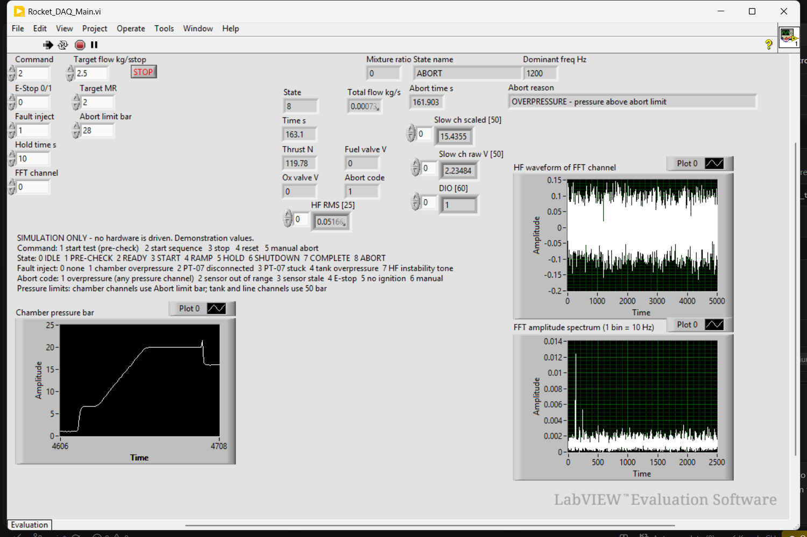
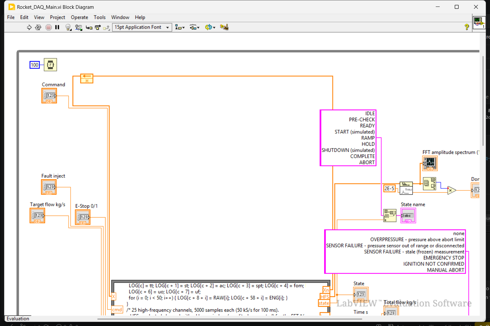
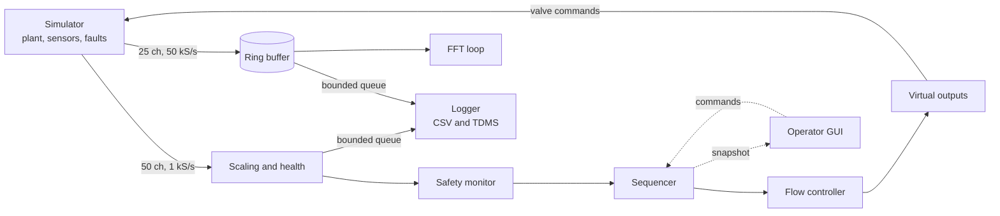
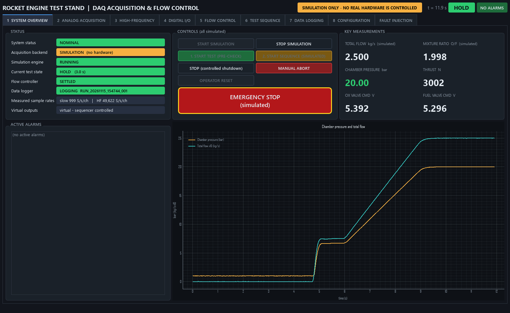
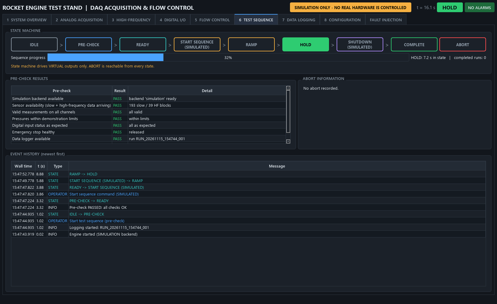

<div align="center">

# Rocket Engine Test Stand
### DAQ Acquisition · Flow Control · Abort Logic

LabVIEW software for a simulated hot-fire test of a liquid rocket engine,<br/>
with a Python reference implementation of the same system.


</div>

> [!NOTE]
> **Simulation only.** Both programs run against a built-in software simulator. No hardware is driven,
> every output is virtual, and all calibrations, set-points and limits are demonstration values.

<br/>

## Highlights

|     | Capability        | Detail                                                                    |
| :-: | :---------------- | :------------------------------------------------------------------------ |
| 📈  | **Slow inputs**   | 50 channels at 1 kS/s — pressure, temperature, flow, load cells           |
| ⚡  | **Fast inputs**   | 25 channels at 50 kS/s — dynamic pressure, vibration                      |
| 🔌  | **Digital I/O**   | 30 inputs, 30 virtual outputs — valves, igniter, purge, E-stop            |
| 🎚️  | **Analog out**    | 2 virtual 0–10 V commands — oxidizer and fuel control valves              |
| 🎯  | **Flow control**  | One loop holding total flow and mixture ratio; anti-windup and rate limit |
| 🚦  | **Sequence**      | Pre-check → Start → Ramp → Hold → Shutdown                                |
| 🛑  | **Abort**         | Any pressure above its limit, sensor failure, E-stop, manual; latched     |
| 💾  | **Logging**       | Every sample, timestamped                                                 |
| 🔬  | **FFT**           | Hann-windowed spectrum and dominant frequency of any fast channel         |

<br/>

## Results

| Check                              | Result                                           |
| :--------------------------------- | :----------------------------------------------- |
| Total flow in HOLD (target 2.5)    | **2.50 kg/s**                                    |
| Mixture ratio in HOLD (target 2.0) | **2.00**                                         |
| Scaling                            | 4.200 V → **40.00 bar**                          |
| FFT of a 1200 Hz, 1.0 signal       | **1200 Hz**, amplitude **1.001**                 |
| Overpressure on any pressure channel | **ABORT** within one loop, valve commands to 0 V |
| Log                                | **54,700 rows × 108 columns**, one row per 1 ms  |

<br/>

## LabVIEW program

**Requires** LabVIEW 2026 Q1 (64-bit)

```text
1.  Open   LabVIEW/ROCKET_ENGINE_DAQ.lvproj
2.  Open   Rocket_DAQ_Main.vi   →   Run
3.  Type a number in  Command  and press Enter
4.  Press  STOP  on the panel to finish
```

<table>
<tr>
<td valign="top">

| Command | Action            |
| :-----: | :---------------- |
|   `1`   | Start test        |
|   `2`   | Start sequence    |
|   `3`   | Stop / cancel     |
|   `4`   | Reset             |
|   `5`   | Manual abort      |

</td>
<td valign="top">

| Fault inject | Effect                  |
| :----------: | :---------------------- |
|     `0`      | None                    |
|     `1`      | Chamber overpressure    |
|     `2`      | Sensor disconnected     |
|     `3`      | Sensor stuck            |
|     `4`      | Tank overpressure       |
|     `7`      | Instability tone        |

</td>
<td valign="top">

| Control          | Purpose                |
| :--------------- | :--------------------- |
| Target flow kg/s | Total-flow set-point   |
| Target MR        | Mixture-ratio set-point|
| Abort limit bar  | Chamber pressure limit |
| Hold time s      | Duration of HOLD       |
| FFT channel      | Fast channel 0–24      |
| E-Stop 0/1       | `1` = emergency stop   |

</td>
</tr>
</table>

A command acts once, when the number changes. To repeat one, enter `0` first.

All 20 pressure channels are checked on every sample. The chamber channels use **Abort limit bar**;
tank, line and injector channels use a fixed 50 bar limit.

### Inside the VI

One While Loop, 100 ms per iteration.

| Block                                      | Role                                                                      |
| :----------------------------------------- | :------------------------------------------------------------------------ |
| **Formula Node**                           | 100 steps of 1 ms: sequence, plant, sensors, scaling, safety, two PI loops, log row. Then 5000 samples for each fast channel |
| **Feedback Node**                          | Carries the state to the next iteration                                   |
| **Reshape Array → Write Delimited Spreadsheet** | Appends 100 log rows per iteration                                   |
| **Amplitude and Phase Spectrum**           | FFT of the selected fast channel                                          |
| **Array Max & Min**                        | Dominant frequency                                                        |
| **Pick Line**                              | State and abort reason as text                                            |

Formula Node source as text: [`LabVIEW/core_formula_node_source.txt`](LabVIEW/core_formula_node_source.txt)

<details>
<summary><b>Abort screenshot</b></summary>
<br/>

</details>

<details>
<summary><b>Block diagram</b></summary>
<br/>

</details>

<details>
<summary><b>LabVIEW tests</b></summary>
<br/>

Three scripts drive the running VI through its front panel. LabVIEW must be open with the VI loaded and idle.

```bash
pip install pywin32
python LabVIEW/Tests/labview_functional_test.py
python LabVIEW/Tests/labview_extended_test.py
python LabVIEW/Tests/labview_text_indicator_test.py
```

| Script                           | Covers                                                                    |
| :------------------------------- | :------------------------------------------------------------------------ |
| `labview_functional_test.py`     | Full sequence, control accuracy, scaling, FFT, four aborts, reset rules, blocked start, log |
| `labview_extended_test.py`       | Set-point changes, saturation and recovery, FFT channels, stop, manual abort, digital outputs, tank overpressure |
| `labview_text_indicator_test.py` | State name, abort reason, dominant frequency                              |

Outputs of the last runs: [`LabVIEW/Results/`](LabVIEW/Results/)

</details>

<br/>

## Python reference implementation

The same system with the structure intended for a real test stand: separate loops for acquisition and
control, fast acquisition, logging, analysis and the operator interface.



**Requires** Python 3.10 or later

```bash
pip install -r requirements.txt

python main.py              # operator GUI
python main.py --demo       # headless demonstration with logging
python -m pytest Tests      # 106 automated tests
```

|                         Overview                          |                        Flow control                        |
| :-------------------------------------------------------: | :--------------------------------------------------------: |
|  |  |
|                  **High-frequency and FFT**                |                          **Abort**                          |
|        |       |
|                   **Analog acquisition**                   |                      **Test sequence**                      |
|  |  |

<br/>

## Repository

```text
LabVIEW/                      LabVIEW project, main VI, tests, results
main.py                       Python entry point
Core/                         Engine: acquisition, analysis and watchdog loops
Simulation/                   Plant model, sensor simulator, fault injection
Acquisition/                  Scaling, channel health, ring buffer, virtual outputs
Flow_Control/                 PID and two-valve flow controller
State_Machine/                Test sequencer
Safety/                       Safety monitor and alarms
Signal_Processing/            FFT and signal statistics
Data_Logging/                 CSV and TDMS logger
DAQ_Hardware_Abstraction/     Backend interface, NI-DAQmx input backend
GUI/                          Operator interface (PyQt6)
Tests/                        Automated tests and demo scripts
docs/                         Design notes, sample runs, screenshots
```

<br/>

## Data and documentation

| Resource                                                                                    | Contents                                         |
| :------------------------------------------------------------------------------------------ | :----------------------------------------------- |
| [`docs/DESIGN.md`](docs/DESIGN.md)                                                           | Assumptions, design, verification, limitations   |
| [`LabVIEW/Results/slow_log_sample_first_3s.csv`](LabVIEW/Results/slow_log_sample_first_3s.csv) | LabVIEW log sample: 1 ms rows, 108 columns       |
| [`LabVIEW/Results/log_columns.txt`](LabVIEW/Results/log_columns.txt)                         | Meaning of each log column                       |
| [`docs/sample_run/nominal/`](docs/sample_run/nominal/)                                       | Python run, full sequence                        |
| [`docs/sample_run/abort/`](docs/sample_run/abort/)                                           | Python run aborted by a sensor failure           |

<br/>

## Scope

- Everything is simulated; nothing here has been run on hardware.
- A software abort on a desktop PC is not a safety system. A real stand needs a hardwired E-stop,
  fail-safe valves and limit checks on deterministic hardware.
- The LabVIEW program is a single loop and logs the slow channels. The multi-loop structure and
  fast-channel logging are in the Python implementation.
- The plant model is illustrative, not an engine model.
