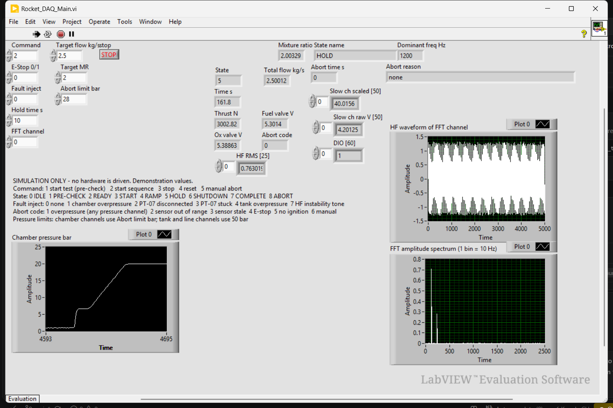
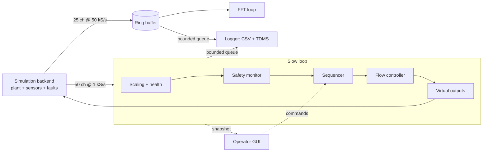
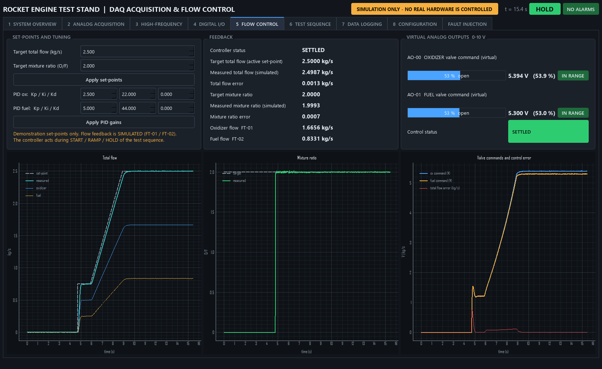
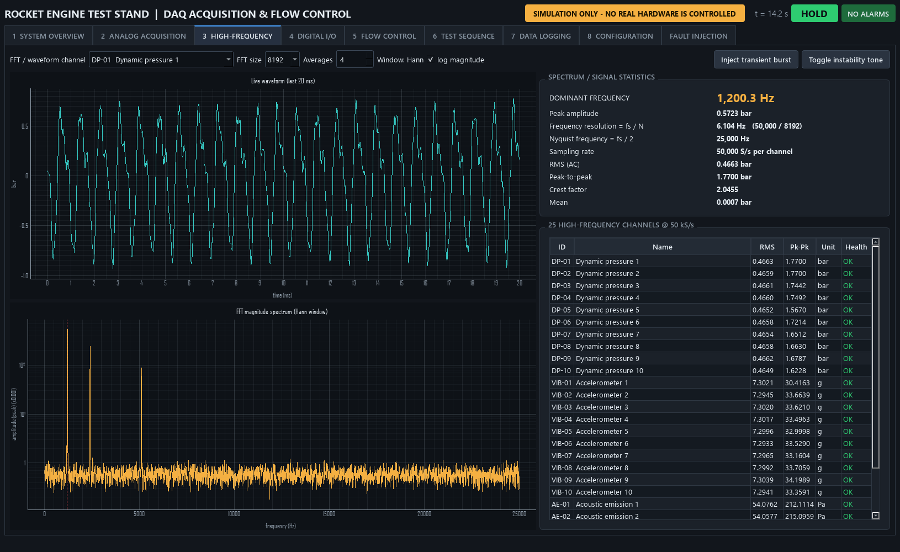
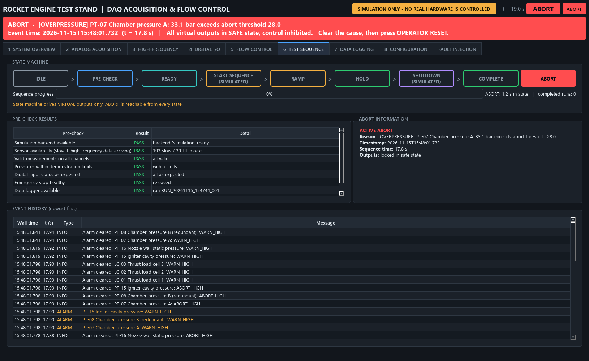
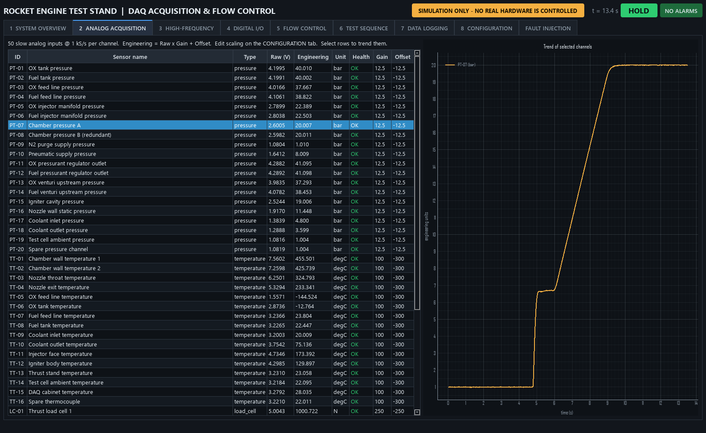

# Rocket Engine Test Stand — DAQ Acquisition and Flow Control

Data acquisition, two-valve flow control, test sequencing and abort logic for a **simulated** hot-fire
test of a liquid rocket engine. Implemented as a **LabVIEW** program, with a **Python** reference
implementation of the same system.

> **Simulation only.** Both programs use a built-in software simulator. No hardware is driven, every
> output is virtual, and all calibrations, set-points and limits are demonstration values.



---

## Features

| Area               | What it does                                                                 |
| :----------------- | :--------------------------------------------------------------------------- |
| Slow acquisition   | 50 analog channels at 1 kS/s — pressure, temperature, flow, load cells       |
| Fast acquisition   | 25 analog channels at 50 kS/s — dynamic pressure, vibration                  |
| Digital I/O        | 30 inputs (limit switches, valve status, E-stop), 30 virtual outputs         |
| Analog outputs     | 2 virtual 0–10 V commands for the oxidizer and fuel control valves           |
| Scaling            | `engineering = volts × gain + offset` on every channel, raw and scaled kept  |
| Flow control       | One loop holding **total flow** and **mixture ratio** with two PI controllers, output clamp, anti-windup and rate limit |
| Test sequence      | IDLE → PRE-CHECK → READY → START → RAMP → HOLD → SHUTDOWN → COMPLETE         |
| Safety             | ABORT on pressure limit, pressure-sensor failure, E-stop or manual command; latched until reset |
| Logging            | Every sample with timestamps                                                 |
| Analysis           | Live waveform and FFT (Hann window) of a selectable fast channel, dominant frequency |
| Fault injection    | Overpressure, disconnected sensor, stuck sensor, instability tone, E-stop    |

---

## Repository layout

| Path                          | Contents                                                   |
| :---------------------------- | :--------------------------------------------------------- |
| `LabVIEW/`                    | LabVIEW project, main VI, automated tests, sample results  |
| `main.py`                     | Entry point of the Python reference implementation         |
| `Core/`                       | Engine: acquisition, analysis and watchdog loops           |
| `Simulation/`                 | Plant model and sensor simulator with fault injection      |
| `Acquisition/`                | Scaling, channel health, ring buffer, virtual outputs      |
| `Flow_Control/`               | PID and the two-valve flow controller                      |
| `State_Machine/`              | Test sequencer                                             |
| `Safety/`                     | Safety monitor and alarm handling                          |
| `Signal_Processing/`          | FFT and signal statistics                                  |
| `Data_Logging/`               | CSV and TDMS logger thread                                 |
| `DAQ_Hardware_Abstraction/`   | Backend interface; NI-DAQmx input backend (inputs only)    |
| `GUI/`                        | Operator interface (PyQt6)                                 |
| `Tests/`                      | Automated tests and demo scripts                           |
| `docs/DESIGN.md`              | Assumptions, design decisions, verification, limitations   |
| `docs/sample_run/`            | Output of a nominal run and an aborted run                 |
| `docs/images/`                | Screenshots                                                |

---

## LabVIEW program

**Requires:** LabVIEW 2026 Q1 (64-bit)

1. Open `LabVIEW/ROCKET_ENGINE_DAQ.lvproj`.
2. Open `Rocket_DAQ_Main.vi` and press **Run**.
3. Type a number in **Command** and press Enter.
4. Press **STOP** on the panel to end the program.

A command acts once, when the number changes. To repeat one, enter `0` first.

### Commands

| Command | Action                                                     |
| :-----: | :--------------------------------------------------------- |
|   `1`   | Start test — pre-check, then **State name** shows READY    |
|   `2`   | Start sequence — START → RAMP → HOLD → SHUTDOWN → COMPLETE |
|   `3`   | Stop (controlled shutdown) or cancel                       |
|   `4`   | Reset to IDLE after COMPLETE or ABORT                      |
|   `5`   | Manual abort                                               |

### Controls

| Control          | Purpose                                             |
| :--------------- | :-------------------------------------------------- |
| Target flow kg/s | Total-flow set-point                                |
| Target MR        | Mixture-ratio set-point                             |
| Abort limit bar  | Chamber-pressure abort limit                        |
| Hold time s      | Duration of HOLD                                    |
| FFT channel      | Fast channel (0–24) shown in the waveform and FFT   |
| E-Stop 0/1       | `1` = emergency stop                                |
| Fault inject     | `0` none · `1` overpressure · `2` sensor disconnected · `3` sensor stuck · `7` instability tone |

### How the VI works

One While Loop running every 100 ms:

| Block                                   | Role                                                                 |
| :-------------------------------------- | :------------------------------------------------------------------- |
| Formula Node                            | 100 steps of 1 ms: sequence, plant, 50 sensors, scaling, safety checks, two PI loops, one log row per step; then 5000 samples for each of the 25 fast channels |
| Feedback Node                           | Carries the state to the next iteration                              |
| Reshape Array → Write Delimited Spreadsheet | Appends 100 log rows per iteration                               |
| Amplitude and Phase Spectrum            | FFT of the selected fast channel                                     |
| Array Max & Min                         | Dominant frequency                                                   |
| Pick Line                               | State and abort reason as text                                       |

The Formula Node source is also available as text: `LabVIEW/core_formula_node_source.txt`.

The log is written to `C:\Users\Public\Documents\rocket_daq_slow_log.csv`, one row per 1 ms sample.
Column meanings are in `LabVIEW/Results/log_columns.txt`; a short sample is in the same folder.

### Abort


### Block diagram


### LabVIEW tests

Three scripts in `LabVIEW/Tests/` set the front-panel controls and read the indicators through
LabVIEW's ActiveX server while the VI runs. LabVIEW must be open with the VI loaded and idle.

```
pip install pywin32
python LabVIEW/Tests/labview_functional_test.py
python LabVIEW/Tests/labview_extended_test.py
python LabVIEW/Tests/labview_text_indicator_test.py
```

| Script                           | Covers                                                                      |
| :------------------------------- | :-------------------------------------------------------------------------- |
| `labview_functional_test.py`     | Full sequence, control accuracy, scaling, FFT, four abort cases, reset rules, blocked start, log file |
| `labview_extended_test.py`       | Set-point changes, valve saturation and recovery, FFT channels, stop, manual abort, digital outputs |
| `labview_text_indicator_test.py` | State name, abort reason, dominant frequency                                |

The output of the last run of each is in `LabVIEW/Results/`.

---

## Python reference implementation

The same system with the structure intended for a real test stand: separate loops for slow
acquisition and control, fast acquisition, logging, analysis and the user interface.



**Requires:** Python 3.10 or later

```
pip install -r requirements.txt
```

| Command                  | Result                              |
| :----------------------- | :---------------------------------- |
| `python main.py`         | Operator GUI                        |
| `python main.py --demo`  | Headless demonstration with logging |
| `python -m pytest Tests` | 106 automated tests                 |

| System overview | Flow control |
| :-------------: | :----------: |
|  |  |

| High-frequency and FFT | Abort |
| :--------------------: | :---: |
|  |  |

| Analog acquisition | Test sequence |
| :----------------: | :-----------: |
|  |  |

---

## Simulation output

| File | Contents |
| :--- | :------- |
| [`LabVIEW/Results/slow_log_sample_first_3s.csv`](LabVIEW/Results/slow_log_sample_first_3s.csv) | LabVIEW log, first 3 s: one row per 1 ms sample, 108 columns |
| [`LabVIEW/Results/log_columns.txt`](LabVIEW/Results/log_columns.txt) | Meaning of each log column |
| [`LabVIEW/Results/`](LabVIEW/Results/) | Output of the three LabVIEW test scripts |
| [`docs/sample_run/nominal/`](docs/sample_run/nominal/) | Python run, full sequence: summary, control data at 50 Hz, events |
| [`docs/sample_run/abort/`](docs/sample_run/abort/) | Python run aborted by a pressure-sensor failure |

Design assumptions, verification and limitations are in [`docs/DESIGN.md`](docs/DESIGN.md).

---

## Scope and limits

- Everything is simulated. Nothing here has been run on hardware.
- A software abort on a desktop PC is not a safety system. A real stand needs a hardwired E-stop,
  fail-safe valves and limit checks on deterministic hardware.
- The LabVIEW program is a single loop; the multi-loop structure exists in the Python implementation.
- The LabVIEW program logs the slow channels; the Python implementation also logs the fast channels (TDMS).
- The plant model is illustrative and is not an engine model.
